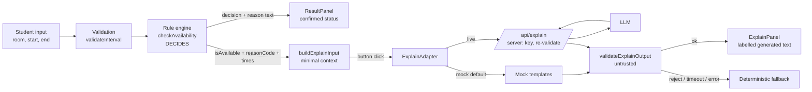

# Practice #11 – Build a small AI-enabled feature

Feature: optional **"Explain availability"** for the Smart Campus Room Availability Checker.
Branch: `feat/week-11-tasks` (base: `e833209`). All checks: `docs/evidence/practice11/01-final.txt`.

**Result in one line:** the deterministic checker still decides; an optional button turns its structured result into a ≤2-sentence explanation through an adapter (mock by default), with input/output validation, timeout and a safe fallback. 149/149 tests, typecheck, lint, build pass; the API key is not in the browser bundle.

---

## Task 01 – Baseline
Checkpoint = branch point `e833209` (`master` HEAD). Before any change (`docs/evidence/practice11/00-baseline.txt`):

| Command | Result |
|---|---|
| `npm test` | 49 passed (3 files) |
| `npm run typecheck` | no errors |
| `npm run lint` | no errors |
| `npm run build` | OK (164 kB JS) |

Where things are: availability rule `src/domain/availability.ts` (`checkAvailability`), UI result `src/components/ResultPanel.tsx`, wiring `src/App.tsx`. The repository had no `AGENTS.md`, although this practice asks for one, so I added it (`AGENTS.md`). Constraints kept: one fictional catalog, no login, no database.

## Task 02 – Feature definition
**User story.** As a student, I want a short explanation of room availability so that I understand the decision.

**Contract**

| | |
|---|---|
| Input | `{ roomLabel, start: "HH:MM"\|null, end: "HH:MM"\|null, isAvailable, reasonCode }` – built only from the checker's result, no booking titles, no owners, no raw user text |
| Output | `{ explanation: string }`, 1–300 chars, ≤2 sentences, plain text |
| Instruction | explain the decision; invent nothing; never override the status |

**Acceptance criteria → where they are enforced**

| AC | Enforcement | Tests |
|---|---|---|
| AC1 rules unchanged | domain change is additive (`code` field only) | 49 old tests unchanged and green |
| AC2 agrees, no invented details | `validateExplainOutput` (client and server) | `explain.test.ts`, `review-findings.test.ts` |
| AC3 bad input rejected | `validateExplainInput` (client and server), body cap | `explain.test.ts` |
| AC4 safe fallback | `explainAvailability` never throws; timeout 3 s; fixed fallback text per reason code | fault-injection tests + UI tests |
| AC5 distinguishable | dashed violet panel, badge, "not a booking confirmation" line, mock labelled | `explain.ui.test.tsx`, screenshots |

**Failure behaviour:** invalid input → "Cannot explain this request"; timeout / error / rejected model output → "Standard explanation (AI not used)" with the cause. The decision above is never touched.

**Flow and trust boundary**

Untrusted: user text (never sent to the model at all, only checker output is) and model output (validated before display). Trusted: the rule engine.

## Task 03 – Build with an AI assistant
Assistant: Claude (Claude Code session, Sonnet 5.5). I reviewed each generated change before committing; see `AI_LOG.md`.

| File | Role |
|---|---|
| `src/ai/explain.ts` | contract, validation, timeout, fallback |
| `src/ai/templates.ts`, `mockAdapter.ts` | mock adapter (default, labelled) |
| `src/ai/faults.ts` | misbehaving adapters for tests / dev demos (`?llm=timeout` etc., dev builds only) |
| `src/ai/httpAdapter.ts`, `serverHandler.ts`, `vite.config.ts` | server side of the adapter; `ANTHROPIC_API_KEY` (no `VITE_` prefix) selects the real provider |
| `src/ai/prompts.ts` | the three prompts |
| `src/components/ExplainPanel.tsx` | button + result panel |

Decisions I made and why:
- **`reasonCode` added to `CheckResult`.** The brief's input contract needs a reason code, but the checker only had free text. Adding an additive field avoids parsing text and keeps `decision`/`reason` identical (AC1).
- **Mock first.** No key or network is needed in class; the same contract is exercised, the UI says "Mock explanation".
- **A real endpoint exists** (dev/preview server) so the "server-side adapter, key not in the browser" boundary is real, not just described.

## Task 04 – Prompt engineering
Prompts are in `src/ai/prompts.ts`; the structured JSON is always the user message, never mixed into the instructions.

| | P1 minimal | P2 explicit limits | P3 strict + reason codes + injection guard + JSON |
|---|---|---|---|
| Returns `{explanation}` JSON (contract) | 0/4 | 0/4 | 4/4 |
| Passes `validateExplainOutput` | 4/4 | 4/4 | 4/4 |
| Unsupported claim (manual check) | **1/4** ("booked by another group") | 0/4 | 0/4 |
| Clarity | clear, but invents a cause | clear | clear, slightly more formal |

**Chosen: P3** (also your choice in chat). Reasons: it is the only one that satisfies the output contract, it lists reason-code meanings so the model does not guess causes, and it tells the model to treat JSON values as data.

**Limits of this comparison (important for the defence):** the samples (`docs/evidence/practice11/prompt-samples.json`) were written by Claude following each prompt, not produced by the app's mock and not by a live API run. One run per cell, so run-to-run consistency was **not measured**. To replace them, run the three prompts against a live model and update the file; `tests/prompt-eval.test.ts` re-scores it. Note the automatic validator cannot catch P1's "another group" claim, which is why the manual column exists.

## Task 05 – Tests (expected vs observed)
Automated: 149 tests (49 old + 100 new). UI scenarios were also run in a real Chrome against the dev server; screenshots in `docs/screenshots/practice11/`, raw log in `docs/evidence/practice11/02-ui-scenarios.json`.

| Scenario | Expected | Observed | Evidence |
|---|---|---|---|
| Available (Engineering Lab 3, 09:00–10:00) | status Available; mock says free | as expected, status unchanged | e01 |
| Overlap (Library A, 09:00–10:00) | Unavailable; explanation, no booking title | as expected ("Physics Study Group" absent from the generated text) | e02 |
| Blocked room (Design Studio 2) | Unavailable; "closed for booking" | as expected | e03 |
| Past time (07:00–08:30) | START_IN_PAST explanation | as expected | e04 |
| Invalid time (empty start) | INVALID_TIME_FORMAT explanation | as expected | e05 |
| Too long (09:00–12:00) | 120-minute explanation | as expected | e06 |
| Empty / overlong input to the contract | rejected | rejected (unit: empty, blank, 81 chars, markup, bad times, mismatched status) | `explain.test.ts` |
| Timeout | fallback "took too long" | as expected (found and fixed a race, see below) | e07 |
| API failure | fallback "service is unavailable" | as expected | e08 |
| Model contradicts status | fallback, safety-check message | as expected | e09 |
| Model invents a detail | fallback, safety-check message | as expected | e10 |
| Mobile 390 px | layout intact | OK | e11 |
| `?llm=live` without a key | must not be labelled AI | "Mock explanation" (after fix B) | e12 |
| UI never changes the decision | decision text identical before/after | identical in all 12 screenshot runs and all UI tests | log json |

Defect found by my own tests: the timeout race (`abort()` before `resolve()` made the cause "error" instead of "timeout"); fixed in the same stage.

## Task 06 – Agentic code review
Reviewer: a separate read-only agent in a clean context. It received the diff range (`e833209..HEAD`), `README.md`, `AGENTS.md` and AC1–AC5, and was told not to modify the repository (`git status` stayed clean). It ran test/typecheck/lint/build and wrote reproductions in `/tmp`.

Findings and my verification (statuses per the practice: confirmed / plausible / unsupported):

| # | Finding | Severity | Status after my check |
|---|---|---|---|
| 1 | Output guard accepts contradictions and invented people/rooms ("occupied", "booked by Dr Kim", "Room 305") | medium | **confirmed** – 8 failing regression tests written first |
| 2 | `?llm=live` without key shows mock text labelled "AI-generated" | medium | **confirmed** – failing test + browser run |
| 3 | `/api/explain` accepts forged context (any 80-char label, `start >= end`), no rate limit or auth | medium | **confirmed** (validator behaviour); cost abuse only plausible |
| 4 | Guard rejects honest negated wording ("no overlap") | low-medium | **confirmed** – 4 failing tests; same function as #1 |
| 5 | Real provider path untested: JSON fences would give 502; model id hard-coded | low | **plausible**, not runnable here (no key/network) |
| 6 | No abort on unmount; 413 never sent by middleware; timeouts 3.0 s vs 2.5 s | low | **confirmed** (code), low impact |
| 7 | Test gaps: vacuous `expect(code).toBeTruthy()`, no `live` test, hand-written prompt samples | low | **confirmed**; vacuous assertion fixed, rest listed below |

I found no unsupported finding. My manual inspection agreed with all of them; two points the reviewer did not make but I note: the validator is a heuristic (sentence-initial invented names such as "Kim has it." still pass), and the prompt samples are not real model output (stated above).

## Task 07 – Repair and regression test
The two most important confirmed findings (by impact on the acceptance criteria):

**Fix A – output guard (findings 1 and 4, AC2).** `validateExplainOutput` now (a) ignores negated claims within four words ("no overlap", "not blocked"), (b) has wider contradiction vocabularies (occupied, taken, reserved, vacant, open, go ahead…), and (c) rejects titles, capitalised names, other rooms and any number not in the supplied facts. *Why necessary:* AC2 was only met for the narrow cases the first tests covered; a model could contradict the checker or invent a person and the UI would show it. Also, honest "no overlap" answers were rejected, so the real model path would mostly fall back.

**Fix B – honest labelling (finding 2, AC5).** The server returns `provider: "mock" | "live"`; the client labels text "AI-generated" only for `live`, and treats missing or unknown as mock. *Why necessary:* AC5 and the "clearly labelled mock" rule; a student must not read template text as model output.

Regression: all 49 original tests still pass, 14 new tests failed before the fixes and pass after, final **149/149**, typecheck, lint, build OK, bundle contains no key.

**Ready for demonstration?** Yes, in mock mode (the default). **Not ready for production in live mode.** Unresolved: #3 (room-name allow-list, `start < end`, rate limiting/auth), #5 (verify against the real API, strip code fences), #6 (abort on unmount, real 413, timeout alignment), test gaps (`live` provider and Vite middleware tests), and the heuristic limits of the validator. Final decision belongs to the human reviewer.

## Discussion
**Why should an LLM explain availability but not determine it?** Availability is a rule over structured data: it must be exact, reproducible and testable. An LLM is probabilistic and can state something fluent but wrong; a wrong "free" means a double booking. So the rule engine is the single source of truth and the LLM only paraphrases its result, which can fail harmlessly (fallback).

**How does an agentic reviewer differ from a linter?** A linter applies fixed syntactic/style rules to code it sees in isolation and is deterministic. An agentic reviewer reads the diff plus related files, tests, README and repo instructions, reasons about intent against the acceptance criteria and can run commands. It finds semantic problems (like findings 1–3) but also produces false or unverifiable claims, so its output is a hypothesis list.

**Which AI-generated finding would you refuse without evidence?** Any claim of a bug or vulnerability with no file/line and no reproduction, especially "fix X" suggestions that change behaviour covered by existing tests. Example here: finding 5 (real provider returns fenced JSON) is plausible but I did not act on it because it cannot be reproduced without a live API.
