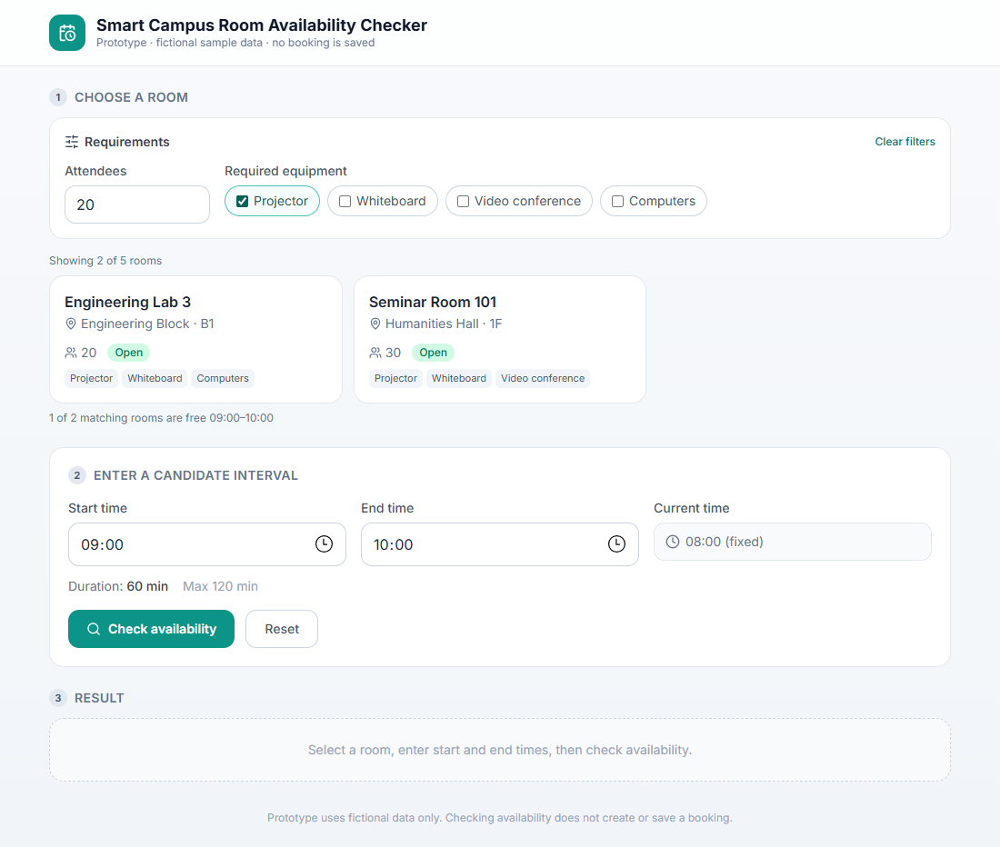
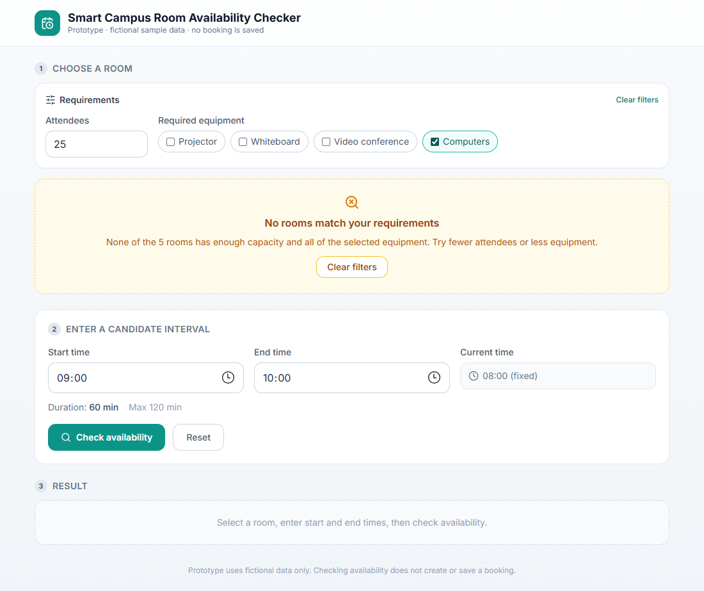
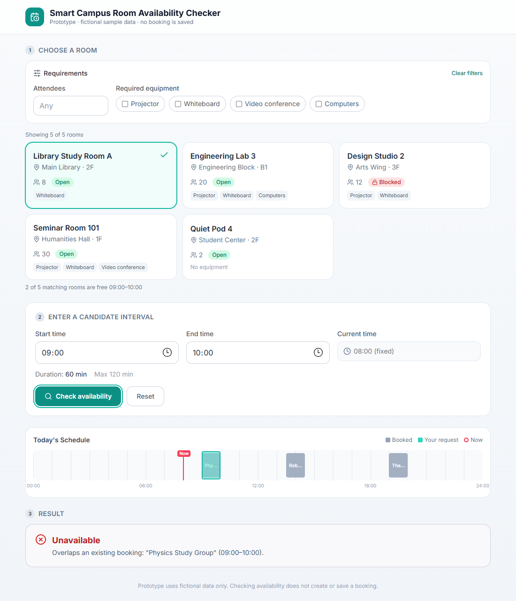
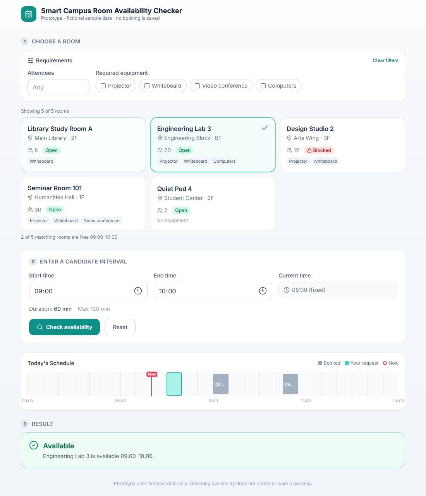
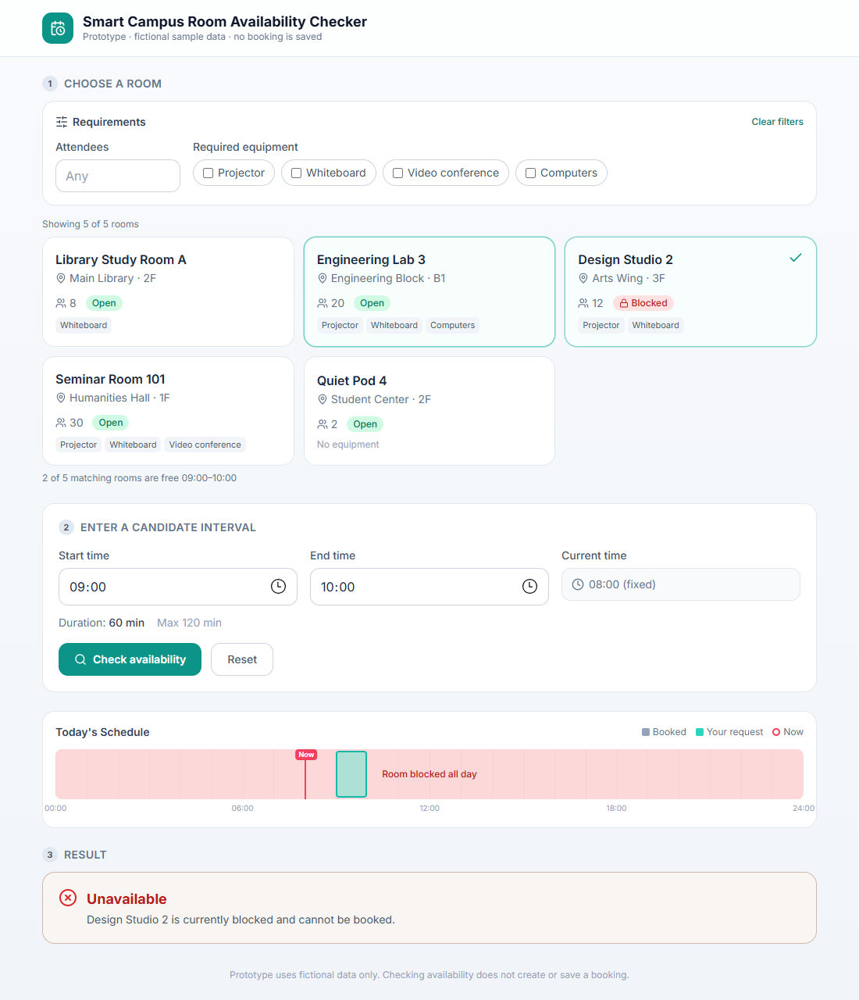
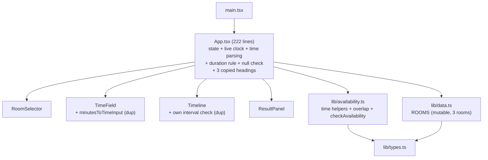
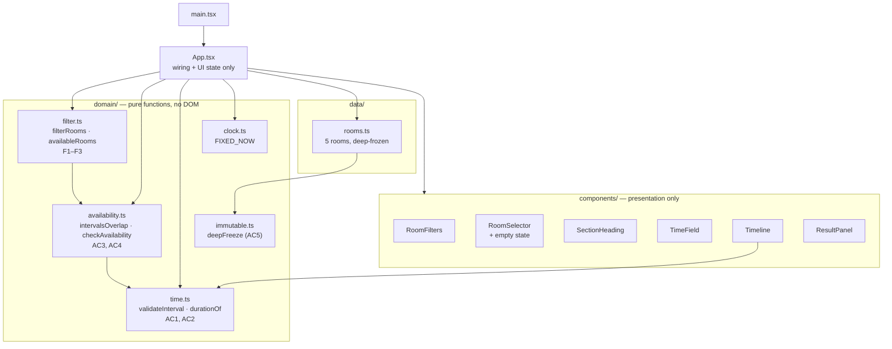

# Assignment #04 — Smart Campus Room Availability Checker
## Analysis, refactoring and quality report

- **Initial version:** tag `v0-baseline` → commit `9badd8c` (the Practice #08 fixed prototype, one-file domain logic, 3 rooms).
- **Final version:** `HEAD` of branch `master` (see `git log v0-baseline..HEAD`).
- **AI assistant:** Claude Code, model Claude Opus 5.5 — full record in [`AI_LOG.md`](../AI_LOG.md).

---

## Task #01 — Codebase analysis

### Context given to the AI assistant
1. **Repository map** (baseline):

| File | Responsibility |
|---|---|
| `src/main.tsx` | React entry point |
| `src/App.tsx` (222 lines) | all state, time parsing, duration hint, live clock, layout of all 3 steps |
| `src/lib/types.ts` | `Booking`, `Room`, `CheckResult` |
| `src/lib/data.ts` | `ROOMS` — 3 fictional rooms (exported mutable array) |
| `src/lib/availability.ts` | time helpers, `intervalsOverlap`, `checkAvailability` (pure) |
| `src/components/RoomSelector.tsx` | room cards |
| `src/components/TimeField.tsx` | `<input type="time">` + unused helper `minutesToTimeInput` |
| `src/components/Timeline.tsx` | day timeline (bookings, candidate, "now") |
| `src/components/ResultPanel.tsx` | Available / Unavailable message |
| `src/lib/roomAvailability.test.ts` | 30 Vitest unit tests |

2. **Acceptance criteria to preserve:** AC1 valid time · AC2 120-minute maximum · AC3 blocked room · AC4 overlap rules (touching is allowed) · AC5 immutable booking data · AC6 clear responsive feedback.
3. **New requirements:** ≥4 rooms with id, name, capacity, equipment, blocked, bookings; F1 capacity ≥ attendees; F2 all selected equipment; F3 blocked never reported available; F4 empty state; F5 switching room refreshes the result.
4. **Constraints:** no login, payments, live APIs or database; fictional data only; fixed current time; small steps, not a rewrite.

### Baseline measurements
| Measure | Value | How obtained |
|---|---|---|
| Tests | **30 passed / 30** | `npx vitest run` → `docs/evidence/00-baseline-tests.txt` |
| Type check | 0 errors | `npx tsc --noEmit -p tsconfig.app.json` |
| Lint | 1 error, 1 warning | `npx eslint .` (unused import in `App.tsx`; non-component export in `TimeField.tsx`) |
| Rooms in catalog | 3, no equipment field | `src/lib/data.ts` |

### Maintainability risks (with references to baseline code)

**R1 — Time/interval validation is duplicated outside the domain module.**
The canonical rules live in `checkAvailability()` (`src/lib/availability.ts:48` start < end, `:55` inside the day, `:70` max 120 min), but they are re-implemented in the UI:
- `App.tsx:58` — `startMin === null || endMin === null` check and its error message exist **only** in the component, so this AC1 rule is not unit-testable;
- `App.tsx:82` — `endMin > startMin` to compute the duration;
- `App.tsx:86` — `duration > MAX_BOOKING_MINUTES` (copy of the AC2 rule);
- `Timeline.tsx:66` — `candidateStart >= 0 && candidateEnd <= MINUTES_PER_DAY && candidateStart < candidateEnd`.
If the 120-minute limit or the day range changes, four places must change together → the UI hint and the real decision can disagree.

**R2 — Booking data is a shared mutable array (AC5 risk).**
`src/lib/data.ts` exports `ROOMS: Room[]` without `readonly` or freezing, and `App.tsx:33` puts that same reference into state. Any `room.bookings.push(...)` or `sort()` anywhere would silently modify the "source of truth" for every later check. There was **no test** for AC5.

**R3 — `App.tsx` is a god-component.**
It owns state, string→minute parsing, duration rules, a live clock (`setInterval` + `new Date()`, `App.tsx:20–45`) and the markup of every step; the section-heading markup is copy-pasted three times (`App.tsx:110, 128, 207`). Adding filters here would make it larger and harder to test.

**R4 — The data model cannot express the new feature.**
`Room` (`src/lib/types.ts`) has no `equipment`; `RoomSelector` always renders every room and has no empty state, so F1–F4 have nowhere to live without touching types, data and UI at once.

**R5 — Non-deterministic "now".**
`App.tsx` read the system clock every second, while the brief requires a fixed current time; results and screenshots depended on when the app was opened.

**R6 — Dead / duplicated helpers.**
`TimeField.tsx:21 minutesToTimeInput()` is just `minutesToLabel()` again (and causes the lint warning); `nowClockLabel()` (`App.tsx:23–29`) re-implements the `padStart` formatting of `minutesToLabel()`; `@supabase/supabase-js` was a dependency although no database is allowed.

**R7 — Test names do not match the brief.**
`roomAvailability.test.ts` labels its groups "AC1 — Overlap", "AC2 — Status", "AC3 — Edge cases", while the brief numbers AC1 = time, AC2 = 120 min, AC3 = blocked, AC4 = overlap, AC5 = immutability. A reviewer cannot map tests to criteria.

### Duplicated-logic inventory (used later as a metric)
Found with `git grep -n` on `v0-baseline` (see Task #05):

| # | Duplicate location | Canonical place |
|---|---|---|
| 1 | `App.tsx:58` null-time check + message | none in domain |
| 2 | `App.tsx:82` start < end for duration | `availability.ts:48` |
| 3 | `App.tsx:86` max-duration check | `availability.ts:70` |
| 4 | `Timeline.tsx:66` interval well-formed check | `availability.ts:48,55` |
| 5 | `App.tsx:23–29` `nowClockLabel` formatting | `minutesToLabel` |
| 6 | `TimeField.tsx:21` `minutesToTimeInput` | `minutesToLabel` |
| 7 | `App.tsx:128` section heading copy | `App.tsx:110` |
| 8 | `App.tsx:207` section heading copy | `App.tsx:110` |

**Total: 8 duplicated logic/rendering locations.**

### Prioritized improvement plan (agreed before editing code)
| Priority | Step | Addresses | Safety net |
|---|---|---|---|
| P0 | Record baseline, tag `v0-baseline`, remove unused DB dependency, fixed current time | R5, R6 | 30 existing tests |
| P1 | Align test names to AC1–AC6 and add the missing AC5 immutability test **before** refactoring | R7, R2 | regression suite |
| P2 | Split into `data/`, `domain/` (time, availability, filter), `components/` | R3 | tests after each move |
| P3 | One `validateInterval()` / `durationOf()` in `domain/time.ts`, used by domain and UI | R1 | AC1/AC2 tests |
| P4 | Deep-freeze room data, `readonly` types | R2 | AC5 test |
| P5 | Extend model with `equipment`, ≥4 rooms; add `filterRooms()`; filter UI + empty state + refresh on room switch | R4, F1–F5 | new F-tests + UI test |

Every step is one commit and is followed by `npx vitest run` and `npx tsc`.

### AI suggestions rejected or modified
1. **Modified — shallow `Object.freeze` for AC5.** The initial plan (AI-generated, in my notes) said "bookings are not mutated (`Object.freeze` / copy)". `Object.freeze(ROOMS)` only freezes the outer array: `ROOMS[0].bookings.push(...)` would still work. I changed it to a recursive `deepFreeze()` and added a test that tries to push into a room's bookings and expects a `TypeError` (see Task #04).
2. **Modified — target structure.** The suggested layout (`main.js`, `ui/render.js`, `domain/*.js`) is for a vanilla-JS app. This project is React + TypeScript, so presentation stays in React components (`src/components/`), and only the pure parts become `src/domain/*.ts` and `src/data/rooms.ts`. A rewrite to another framework was not considered — the brief asks for small steps.
3. **Modified — "write regression tests for ~1 hour".** The plan assumed no tests existed. The baseline already had 30 passing tests that cover AC1–AC4, so instead of rewriting them I only renamed the groups to the brief's AC numbers and added the missing AC5 test.

---

## Task #02 — Feature extension (room catalog and filters)

**Catalog** (`src/data/rooms.ts`): 5 fictional rooms, each with `id`, `name`, `building`, `capacity`, `equipment[]`, `blocked`, `bookings[]`.

| Room | Capacity | Equipment | Blocked | Bookings |
|---|---|---|---|---|
| Library Study Room A | 8 | whiteboard | no | 09:00–10:00, 13:30–14:30, 19:00–20:00 |
| Engineering Lab 3 | 20 | projector, whiteboard, computers | no | 12:00–13:00, 16:30–17:30 |
| Design Studio 2 | 12 | projector, whiteboard | **yes** | all day (maintenance) |
| Seminar Room 101 | 30 | projector, whiteboard, video conference | no | 09:00–11:00, 15:00–17:00 |
| Quiet Pod 4 | 2 | — | no | 10:00–11:00 |

**Rules** (`src/domain/filter.ts`, pure functions):
- **F1** `hasCapacityFor(room, attendees)` → `room.capacity >= attendees`. An empty field means no requirement; `0`, negative, fractional or non-numeric input shows an inline error.
- **F2** `hasAllEquipment(room, required)` → `required.every(item => room.equipment.includes(item))`.
- **F3** `availableRooms(...)` re-uses `checkAvailability()` per room. A blocked room can match the filters (it is shown with a red *Blocked* badge) but is never counted or reported as available.
- **F4** `RoomSelector` renders an amber empty state ("No rooms match your requirements") with a *Clear filters* button.
- **F5** In `App.tsx` the result is *derived* (`useMemo`) from the currently selected room. After *Check availability* has been pressed, clicking another room re-runs the check against **that room's own bookings**. Changing the times clears the result as before. A room hidden by the filters is deselected.

**Demonstration** (screenshots in `docs/screenshots/`, captured with Playwright + Edge on the running dev server; "Observed" is the text the page showed):

| # | Scenario | Observed |
|---|---|---|
| 01 | Initial page | 5 of 5 rooms, fixed time 08:00 |
| 02 | Successful filter: 20 attendees + Projector | "Showing 2 of 5 rooms" (Engineering Lab 3, Seminar Room 101) |
| 03 | Unsuccessful filter: 25 attendees + Computers | "No rooms match your requirements" |
| 04 | Check Library Study Room A 09:00–10:00 | **Unavailable** – overlaps "Physics Study Group" |
| 05 | Switch to Engineering Lab 3 (no re-click) | **Available** – Engineering Lab 3 09:00–10:00 |
| 06 | Switch to Design Studio 2 | **Unavailable** – room is blocked |
| 07 | Engineering Lab 3 09:00–11:01 | **Unavailable** – 121 minutes > 120 |
| 08 | Engineering Lab 3 09:00–11:00 | **Available** – exactly 120 minutes |
| 09 | Phone width 390 px | single column, `scrollWidth = 390` (no horizontal scroll) |







---

## Task #03 — Refactoring

### Before (`v0-baseline`)


### After (`HEAD`)


### Responsibilities after refactoring
| Module | Responsibility | Uses DOM/React? |
|---|---|---|
| `src/data/rooms.ts` | fictional catalog only | no |
| `src/domain/time.ts` | parse/format times, **one** interval validation (AC1, AC2) | no |
| `src/domain/availability.ts` | overlap rule and the room decision (AC3, AC4, AC6 messages) | no |
| `src/domain/filter.ts` | capacity / equipment filters, available rooms (F1–F3) | no |
| `src/domain/immutable.ts` | `deepFreeze` (AC5) | no |
| `src/domain/clock.ts` | fixed current time | no |
| `src/domain/types.ts` | read-only `Room`, `Booking`, `Equipment`, `CheckResult` | no |
| `src/components/*` | rendering and user events only | yes |
| `src/App.tsx` | holds UI state and connects domain → components | yes |

### Design decisions (justified)
1. **Domain logic as pure functions without DOM/React.** All rules (`validateInterval`, `checkAvailability`, `filterRooms`, `availableRooms`) take plain data and return plain data. *Why:* they can be tested in milliseconds in Node without a browser (45 of the 49 tests are pure-function tests), and the UI cannot re-implement a rule by accident. This removed the 4 copies of time/duration logic that lived in `App.tsx` and `Timeline.tsx`.
2. **One validation function shared by the decision and the hints.** `validateInterval()` is the only place that knows the AC1/AC2 rules; the duration hint uses `durationOf()` / `exceedsMaxDuration()` from the same file. *Why:* before, the red "exceeds 120 minutes" hint and the real decision were two separate comparisons that could drift apart.
3. **Immutable data: deep-frozen catalog + `readonly` types (AC5).** *Why:* the compiler now rejects `room.bookings.push(...)`, and at run time a mutation throws `TypeError` (tested). A shallow `Object.freeze` was not enough (see AI suggestion #1).
4. **Derived result instead of stored result (F5).** The result is computed from `(checked, selectedRoom, start, end)` with `useMemo`, not stored with `setResult`. *Why:* it cannot get out of sync with the selected room. Switching rooms automatically re-checks against that room's bookings, and a filtered-out room cannot keep showing an old answer.
5. **Injectable data for tests.** `App` accepts optional `rooms` and `currentTime` props (defaults: the catalog and `FIXED_NOW`). *Why:* UI tests can use deterministic data without module mocking.

### Behaviour kept consistent
- All 30 original tests still pass. The only edits to them: group titles renamed to the brief's AC numbers, imports updated after the file move, and `equipment: []` added to the test fixture once the model gained that field.
- User-facing messages are identical (strings moved, not rewritten).
- One intentional change: the live clock was replaced by a fixed time (08:00), as the brief requires.

---

## Task #04 — Automated testing

**Command:** `npx vitest run` (same as `npm test`). Full verbose output: `docs/evidence/01-final-tests.txt`.

```
 ✓ tests/filter.test.ts (11 tests)
 ✓ tests/regression.test.ts (34 tests)
 ✓ tests/app.ui.test.tsx (4 tests)
 Test Files  3 passed (3)
      Tests  49 passed (49)
```

| Area | File | What is checked (boundaries in bold) |
|---|---|---|
| AC1 valid time | `regression.test.ts` | start = end, start > end, outside 00:00–24:00, not after "now", empty (null) start/end, malformed labels |
| AC2 120-min max | `regression.test.ts` | **exactly 120 accepted**, **121 rejected** |
| AC3 blocked | `regression.test.ts` | blocked room always Unavailable |
| AC4 overlap | `regression.test.ts` | contained, leading, trailing, identical, enveloping; **touching 10:00–11:00 / 11:00–12:00 allowed** |
| AC5 immutable | `regression.test.ts`, `filter.test.ts` | catalog deep-equal after checks and filters; `push` into bookings throws |
| AC6 feedback | `regression.test.ts`, UI test | decision + reason text names the room / the clashing booking |
| Catalog | `filter.test.ts` | ≥4 rooms, all required fields, unique ids |
| F1 capacity | `filter.test.ts` | **capacity = attendees kept**, **attendees = capacity + 1 dropped**, empty = no limit, invalid input rejected |
| F2 equipment | `filter.test.ts` | room with only part of the equipment excluded; capacity + equipment combined |
| F3 blocked | `filter.test.ts` | blocked room matching every filter is not in `availableRooms` |
| F4 empty | `filter.test.ts`, UI test | empty list; empty-state text in the DOM; *Clear filters* restores the list |
| F5 room switch | `filter.test.ts`, UI test | rooms A and B give opposite results for the same interval; in the DOM, clicking another room changes the result |
| UI integration | `app.ui.test.tsx` (jsdom + Testing Library) | typing attendees / ticking equipment updates the rendered list; empty state; room-switch re-check; inline attendee error |

**Can the tests fail?** Six rules were broken on purpose (mutation check, `docs/evidence/02-mutation-check.txt`). Every mutant made at least one test fail:

| Mutant | Failing tests |
|---|---|
| overlap `<` → `<=` (touching = conflict) | 4 |
| capacity `>=` → `>` | 3 |
| equipment `every` → `some` | 6+ |
| duration `>` → `>=` 120 | 1 |
| deep freeze → shallow freeze | 1 |
| room switch resets instead of re-checking | 1 |

Other checks: `npx tsc --noEmit -p tsconfig.app.json` → 0 errors; `npx eslint .` → 0 problems.

---

## Task #05 — Quality evaluation (before → after)

| Measure | Before (`v0-baseline`) | After (`HEAD`) | How it was obtained |
|---|---|---|---|
| Automated tests passed / total | **30 / 30** (1 file) | **49 / 49** (3 files) | `npx vitest run` → `docs/evidence/00-baseline-tests.txt`, `01-final-tests.txt` |
| Tests for AC5 / F1–F5 / UI behaviour | 0 / 0 / 0 | 3 / 9 (+1 catalog) / 4 | counted `it(` blocks per `describe` in `tests/` |
| Mutants killed | not measured | 6 / 6 | `docs/evidence/02-mutation-check.txt` |
| Duplicated logic/rendering locations | **8** | **0** | same `git grep -nE` pattern on both versions (`docs/evidence/03-metrics.txt`); the remaining matches are the single canonical definitions in `domain/time.ts` and `SectionHeading.tsx` |
| Lint problems | 1 error, 1 warning | 0 | `npx eslint .` |
| Type errors | 0 | 0 | `npx tsc --noEmit -p tsconfig.app.json` |
| Code structure | 3 `lib/` files mixing helpers, rules and data; logic also in 2 components | 7 domain modules (incl. types) + 1 data module + 6 presentation components + `App` wiring | file tree; table in Task #03 |
| Rooms / filters | 3 rooms, no filters | 5 rooms, capacity + equipment filters | `src/data/rooms.ts` |
| Shared data mutable? | yes (`ROOMS: Room[]`) | no (deep-frozen, `readonly`) | AC5 tests |
| Runtime dependencies | 4 (incl. unused Supabase) | 3 | `package.json` |
| Size of change | — | +879 / −318 lines in `src` + `tests` | `git diff --stat v0-baseline..HEAD -- src tests` |

### Remaining limitations
1. **`App.tsx` is still the largest file (224 lines vs 222).** It no longer contains rules, but it still owns all UI state. The next step would be a `useRoomSearch()` hook so state transitions can be unit-tested on their own.
2. **Single day, check-only.** Bookings are fixed fictional data for "today"; nothing can be created or saved (by design of the brief, but it limits realism).
3. **`availableRooms()` is O(n²)** because each check looks the room up again in the catalog. Irrelevant for 5 rooms, but a real catalog would need an index.
4. **UI coverage is behavioural, not visual.** The jsdom tests do not check layout; responsiveness was verified only by one 390-px screenshot, not by an automated test.

---

## Task #06 — AI reflection

**Context I gave the assistant.** I worked with Claude Code (Claude Opus 5.5) inside my repository, so it could read the code itself. I gave it the assignment PDF, my own step-by-step plan, the acceptance criteria AC1–AC6, the new rules F1–F5 and the constraints: no login, database or live API, fictional data, fixed current time, and small steps instead of a rewrite.

**Useful and incorrect suggestions.** The most useful outputs were the risk list with exact file and line references, the idea of a single `validateInterval()` used by both the decision and the UI hint, and the mutation check, which showed that the tests really fail when a rule breaks. Several suggestions were wrong or weak. The plan assumed vanilla JavaScript and no existing tests. It proposed a shallow `Object.freeze`, which would not have protected nested bookings. One draft silently treated invalid attendee input as "no filter". Another used type casts and an `eslint-disable` to hide problems instead of fixing them, and the first metrics table miscounted tests and components.

**What I verified personally.** I re-ran `npx vitest run`, `tsc` and `eslint` and checked that the outputs matched the saved evidence. I opened the referenced lines in `v0-baseline` and went through the filtering scenarios in the browser. I also compared the free-room count with the booking data by hand.

**How tests influenced decisions.** The 30 existing tests were the safety net that allowed moving files and merging validation without fear. The AC5 test forced deep freezing instead of shallow freezing. The UI test for F5 led to computing the result from the selected room instead of storing it.

**What I would improve next.** I would move the UI state into a `useRoomSearch()` hook, add an automated responsive-layout check, and index rooms by id.
